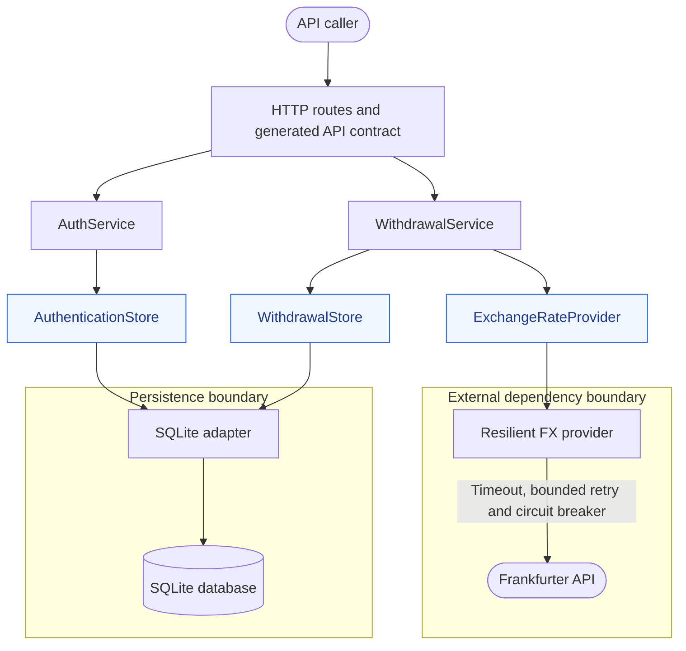
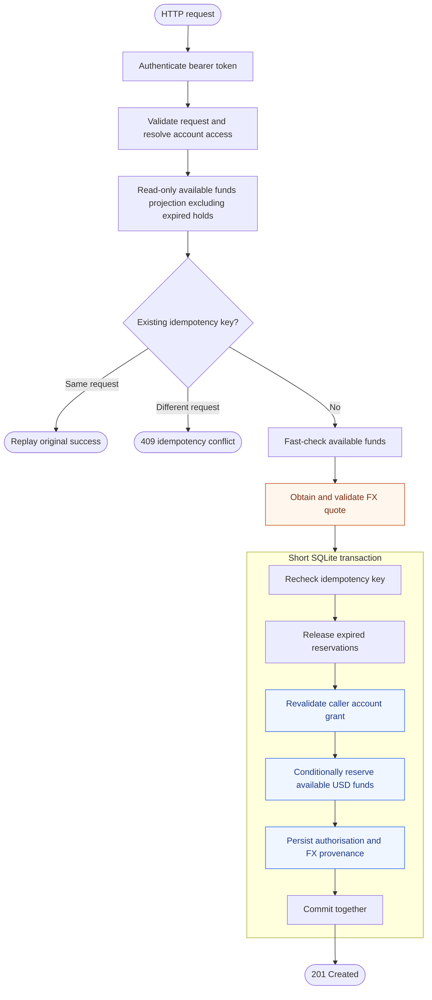

# OpenFn withdrawal-authorisation service

A small Node.js + TypeScript service that authorises USD withdrawals and converts the amount into the caller's chosen currency using Frankfurter.

## Quick start

Requirements: Node **22.16.x** (see `.nvmrc`).

```bash
nvm use
npm ci
npm run build
npm run seed
npm start
```

Server: `http://localhost:3000`

Interactive API documentation: `http://localhost:3000/docs`

OpenAPI document: `http://localhost:3000/openapi.json`

Run all verification:

```bash
npm run verify
```

The normal server **does not silently provision accounts or credentials**. `npm run seed` explicitly creates the demonstration fixtures described below.

## Example request

```bash
curl -i \
  -X POST http://localhost:3000/v1/accounts/acc_1001/withdrawals \
  -H 'Authorization: Bearer demo-alice-token' \
  -H 'Idempotency-Key: example-operation-001' \
  -H 'Content-Type: application/json' \
  -d '{"amount":"125.50","target_currency":"EUR"}'
```

A successful response follows the exercise contract:

```json
{
  "id": "wd_...",
  "account_id": "acc_1001",
  "status": "authorised",
  "authorisation_code": "ABCD-EFGH-JKLM-NPQR",
  "amount_usd": "125.50",
  "target_currency": "EUR",
  "converted_amount": "115.46",
  "exchange_rate": "0.92",
  "created_at": "2026-10-17T12:00:00.000Z",
  "expires_at": "2026-10-17T12:05:00.000Z"
}
```

## Core domain assumption: authorisation is not settlement

A successful request reserves available USD funds; it leaves the posted balance unchanged. The configurable lifetime defaults to five minutes and starts after FX completes. The response returns the persisted UTC `expires_at`, unchanged on replay. Expired holds stop reducing projected availability; stored cleanup commits with the next successful new authorisation. Capture/settlement is outside scope.

## Architecture



The application uses narrow ports for identity/account state and the external FX dependency.

## Core workflow



FX runs outside the transaction. The read-only precheck discounts expired holds; the transaction rechecks idempotency, permissions and funds, then commits cleanup and the new reservation together. Failure rolls back all transaction changes.

## Explicit demo seed matrix

Run `npm run seed` to provision the fixtures.

| Token | Principal | Access pattern |
|---|---|---|
| `demo-alice-token` | `user_alice` | multiple accounts: `acc_1001`, `acc_1002`, `acc_shared` |
| `demo-bob-token` | `user_bob` | exactly one account: `acc_2001` |
| `demo-carol-token` | `user_carol` | authenticated but no account access |
| `demo-dave-token` | `user_dave` | multiple/shared grants: `acc_2001`, `acc_shared` |
| `demo-revoked-token` | revoked principal | token exists but is rejected |

`acc_unassigned` exists but has **no grants**, so the fixtures also cover an account inaccessible to every demo principal.

The seed is intentionally explicit rather than executed automatically during normal startup.

## Key decisions

| Area | Choice |
|---|---|
| Persistence | SQLite provides real transactions and constraints with minimal setup. |
| Access | Hashed bearer tokens establish identity; grants are rechecked at reservation time. Missing and inaccessible accounts both return 404. |
| Retries | Optional idempotency keys give one logical request one reservation; conflicting reuse returns 409. |
| Money | Integer USD cents and exact decimal FX arithmetic; half-up rounding to target ISO minor units. |
| FX failures | Timeout, bounded retries with jitter and a process-local circuit breaker; no account writes on failure. |
| Provisioning | Explicit seed fixtures; account creation and token issuance belong to their owning account/identity domains. |

Authorisation codes are cryptographically random server-side references, not independent proof of identity or account authority. Capture, identity issuance, provider failover/caching and additional infrastructure are deliberately deferred pending business requirements.

## Verification and documentation

`npm run verify` runs typecheck, all tests and the production build. Tests target reservation safety, permissions, retries, rollback, expiry, real SQLite persistence, the local FX HTTP boundary, protocol contracts and money boundaries.

- [Service guide](docs/SERVICE_GUIDE.md): security, HTTP errors, resilience, configuration, test strategy and deliberate omissions.
- [Engineering decisions](DECISIONS.md): rationale and production evolution.
- [AI usage](AI_USAGE.md): tools, material review findings and human control.
- [Agent instructions](AGENTS.md) and [change protocol](docs/ai/CHANGE_PROTOCOL.md): impact analysis, verification, review and human approval.

Configuration is documented in [.env.example](.env.example). API documentation is generated from the route contracts and served at `/docs` and `/openapi.json`.
